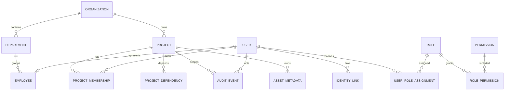

# ASAA1229 Shared Data Architecture

**Date:** 2026-11-25  
**Status:** Owner-approved architectural direction; logical model proposed for implementation planning. Physical databases, schemas and APIs must be verified against each project's existing implementation before migration.

## 1. Approved direction

- Shared/centralized local database infrastructure.
- Separate project databases plus shared organizational databases (hybrid model).
- PostgreSQL for relational data and transactions.
- MongoDB only for workloads that have a demonstrated document-storage need.
- Centralized, versioned APIs/services are the default cross-project access path.
- Direct database access across projects is exceptional and requires documented justification, least-privilege service identity and explicit data ownership.
- Keep operating cost at ₹0 and use the owner's existing local PostgreSQL and MongoDB installations.
- Use dummy data until real data is authorized. Request connection details only when required.

## 2. Logical database topology

Names below are proposed logical names, not a claim that databases have already been created.

### PostgreSQL

| Logical database / domain | Purpose | Owner / system of record | Consumers |
|---|---|---|---|
| asaa_shared | Canonical organization, identity references, departments, project registry, role/permission definitions, common configuration and audit metadata | ASAA organization platform (with identity provider as authentication authority) | Authorized ASAA services |
| asaa_operations | ASAA operational workflows: governance, supplier/AP/AR, HR/payroll foundations and operational records | ASAA | ASAA API and authorized reporting services |
| templates | Templates projects, requirements, catalog, blueprints, generation metadata, workspace and certification records | Templates | Templates API only |
| portfolio (conditional) | Relational portfolio metadata only if/when the current storage model requires it | Portfolio | Portfolio server only |
| jarvis (conditional) | Structured assistant metadata only if local file/state storage becomes insufficient and owner approves the data boundary | JARVIS | JARVIS local service only |

Do not create empty databases merely to match this table. Reuse current project persistence where appropriate and migrate only after schema, data ownership and rollback are defined.

### MongoDB

MongoDB is an available local capability, not a mandatory dependency for every project. Use it only for a justified document-oriented workload such as flexible document metadata, event payload archives or versioned knowledge documents where relational storage is not the better fit.

Before adding a MongoDB database/collection, document:
- why PostgreSQL or object/file storage is unsuitable;
- data owner and source of truth;
- document schema/version and validation;
- indexes and query patterns;
- access scopes, retention, backup and deletion;
- whether the data is sensitive or personal.

Do not copy employee, user, project or permission master records into MongoDB. Reference canonical IDs and retrieve authoritative records through their owning service.

## 3. Shared organizational data domains

| Domain | Core entities | Relationships | Authority |
|---|---|---|---|
| Organization | Organization, Department, Location, OrganizationUnit | Organization has departments/units; departments may have parent units | ASAA organization service |
| Identity | User, IdentityLink, AuthenticationMethod, SessionReference | User may link to one or more external/local identities; credentials remain with identity provider | Local identity provider for authentication; ASAA identity mapping for organization association |
| People | Employee, EmploymentRecord, DepartmentMembership | Employee maps to a User where applicable; employee has employment history and department membership | ASAA HR domain |
| Authorization | Role, Permission, RolePermission, UserRoleAssignment, ProjectMembership | Roles grant permissions; users receive roles within a defined organization/project scope | ASAA authorization service; project-specific authorization remains enforced by each project |
| Portfolio registry | Project, Repository, ProjectOwner, ProjectDependency, ProjectCheckpoint | Organization owns projects; projects map to repositories, owners, dependencies and checkpoints | ASAA organization service |
| Audit | AuditEvent, ActorReference, ResourceReference, CorrelationReference | Events reference actor, organization, project/resource and correlation ID | Each service writes its own audit events; shared reporting reads authorized summaries |
| Configuration | ConfigurationItem, FeatureFlagReference, EnvironmentReference | Config items have project/environment scope and version | Owning project/configuration service |
| Assets | AssetMetadata, AssetVersion, AssetOwner, AssetPermission | Assets may belong to a project/profile and have versions/permissions | Owning project; binaries remain in approved object/file storage |

## 4. Conceptual relationships

The following is a conceptual relationship map. It is not a physical migration script.

## 5. Cross-project relationship rules

1. A shared entity has one authoritative owner. A consumer stores a canonical ID, not a copied editable master record.
2. Project-specific records remain in their project database.
3. Cross-project reads/writes use authenticated APIs with explicit scopes, versioned contracts and audit correlation.
4. Do not create cross-database foreign-key assumptions. Enforce cross-project references through API validation and reconciliation.
5. API calls must be idempotent where retries are possible; use correlation IDs, bounded retries, timeouts and clear error handling.
6. No implicit trust: each service authenticates independently and receives only the minimum required permissions.
7. Shared reporting receives only the fields needed for its purpose; sensitive payroll, identity and personal data are not broadly replicated.
8. Project owners can correct their project data; shared master-data corrections happen through the authoritative owner service.

## 6. API-first integration boundaries

Proposed service boundaries:
- Organization API: organization structure, project registry, ownership and dependency references.
- Identity/Authorization API: user-to-organization mapping, role assignments and scoped permission decisions.
- Audit API: append-only event ingestion and permission-filtered query.
- Configuration API: approved non-secret configuration metadata and feature flags.
- Project APIs: ASAA, Templates, Portfolio and JARVIS domain-specific operations.

Actual service names, routes and event schemas must be mapped to existing project APIs before implementation. Do not create a new API gateway or shared runtime merely to satisfy this logical model.

## 7. Data security and lifecycle

- Classify data as public, internal, confidential or restricted before cross-project sharing.
- Apply RBAC and least privilege at API and database layers.
- Use separate database roles per service; do not share superuser credentials with applications.
- Keep secrets outside database records and source control.
- Encrypt connections where supported and encrypt backups; local loopback development may use the project's documented local-only settings.
- Define retention, archival, deletion and legal-hold behavior for each data domain.
- Audit access to restricted records and administrative changes.
- Separate development/test data from real employee/client data.
- Use dummy/synthetic data for demos and tests.
- Backups must include databases and required metadata; test restores into isolated databases.
- Document RPO/RTO values as proposals until the owner confirms business targets.

## 8. Environment variables and local connectivity

Each project documents only the variables it actually consumes. Typical examples include:
- PostgreSQL: project-specific DATABASE_URL with USER/PASSWORD placeholders and local host/port.
- MongoDB, only when implemented: MONGODB_URI and database name with safe placeholders.
- API integrations: base URL, client ID, token URL, client secret and scopes where applicable.
- Local identity: issuer, JWKS URL, client ID and optional client secret.
- Backups: backup directory, encryption-key reference, retention and schedule settings.

Actual connection strings and secrets belong in private ignored .env files. Example files contain placeholders only. The owner will provide values when a concrete task requires them.

## 9. Migration and rollout controls

1. Inventory current databases, tables, collections, files and data owners.
2. Map existing fields to canonical entities and identify duplicate records.
3. Define versioned schema/API contracts and migration compatibility.
4. Add migrations and rollback/restore tests in the owning project.
5. Validate with dummy data and least-privilege service roles.
6. Run integration tests and backup/restore tests.
7. Keep old paths available until the new path is verified.
8. Do not migrate real data, enable cross-project access or deploy production integrations without explicit owner authorization.

## 10. Decisions deliberately not assumed

- Exact production database names, ports, users and passwords.
- Which domains require MongoDB rather than PostgreSQL/object storage.
- Final data classification and retention periods.
- Numeric business RPO/RTO commitments.
- A central API gateway, event broker or external cloud database.
- Any paid database, hosted identity or third-party integration.

These are implementation-specific or future decisions. Continue local and mock-based work without waiting for them.
